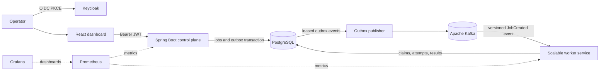
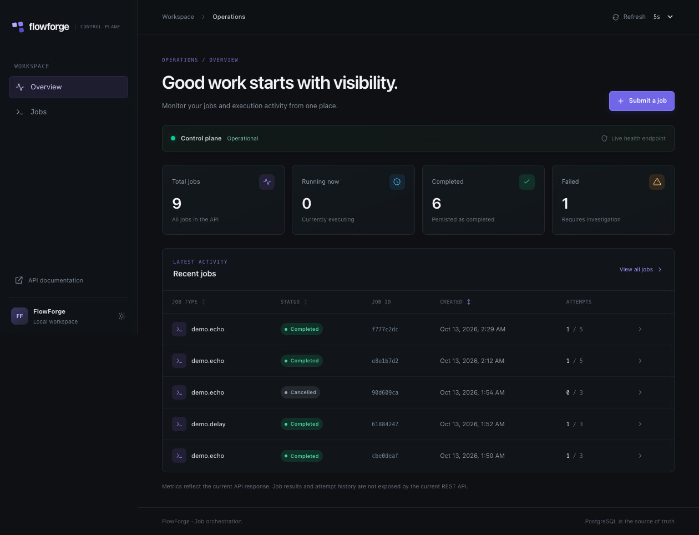
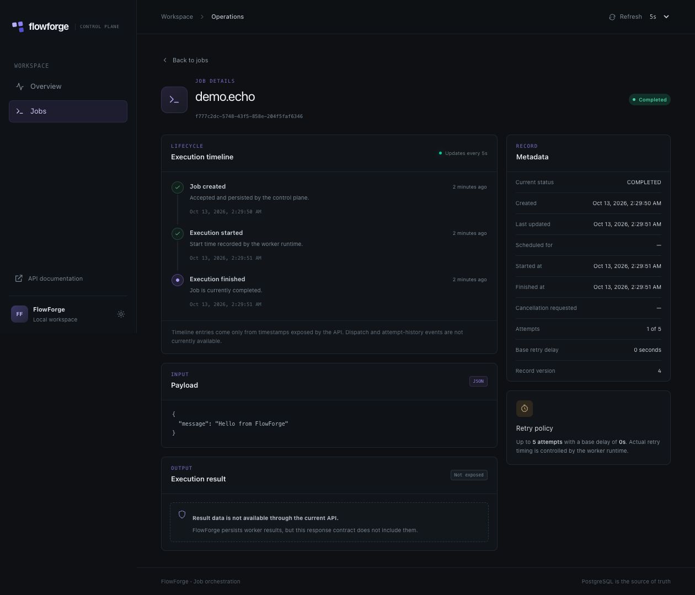

# FlowForge

**Durable, observable background job orchestration built with Spring Boot,
PostgreSQL, Kafka, and React.**

FlowForge is a distributed workflow orchestration platform for defining,
submitting, scheduling, and observing durable background jobs. The control
plane uses Java 21 and Spring Boot with PostgreSQL persistence, a versioned job
management API, and transactional outbox publication to Apache Kafka. A
separate Spring Boot worker service consumes dispatch events and executes
registered job handlers. The React/TypeScript operator dashboard provides live
job visibility and lifecycle controls. Browser users authenticate through
Keycloak OIDC; the control plane validates signed access tokens and enforces
roles plus per-user job ownership. Redis and workflow authoring remain planned
components.

## Architecture at a glance

The control plane exposes job creation, listing, detail, and cancellation
endpoints. Flyway manages the PostgreSQL schema; the API persists jobs and
returns DTOs, not JPA entities. PostgreSQL remains the source of truth. A
database-backed outbox publisher claims eligible events and delivers them to
Kafka; independently scalable workers claim execution attempts and persist
results in PostgreSQL. Redis is planned only for short-lived coordination and
caching.

See [docs/IMPLEMENTATION_PLAN.md](docs/IMPLEMENTATION_PLAN.md) for the
architecture, service boundaries, data model, lifecycle, and roadmap.
Milestone status is tracked in [docs/PROGRESS.md](docs/PROGRESS.md).
Authentication and local identity-provider setup are described in
[docs/SECURITY_ARCHITECTURE.md](docs/SECURITY_ARCHITECTURE.md) and
[docs/AUTHENTICATION_SETUP.md](docs/AUTHENTICATION_SETUP.md).
The reproducible end-to-end runtime demonstration and observed verification
evidence are in [docs/E2E_DEMO.md](docs/E2E_DEMO.md).
The dashboard screenshots below were captured from the running UI connected to
the local control plane.



### Engineering highlights

- Durable job state, scheduling metadata, ownership, and execution attempts in
  PostgreSQL with additive Flyway migrations.
- Transactional idempotent submission and outbox publication with bounded
  retries, claim leases, and crash recovery.
- Independently scalable Kafka workers with atomic claims, heartbeats, fencing
  tokens, cooperative cancellation, and retryable/permanent failure handling.
- Keycloak OIDC Authorization Code + PKCE, JWT issuer/audience/signature
  validation, ADMIN/OPERATOR/VIEWER roles, and per-user job ownership.
- Responsive React/TypeScript dashboard with live job polling and API-backed
  lifecycle controls.
- Local Docker Compose stack and automated Maven, Testcontainers, and frontend
  verification.

## Technology

| Area | Technologies |
| --- | --- |
| Control plane and workers | Java 21, Spring Boot 3, Maven |
| Persistence and migrations | PostgreSQL 16, Spring Data JPA, JDBC, Flyway |
| Messaging | Apache Kafka 3, transactional outbox |
| Identity | Keycloak, OpenID Connect, Spring Security OAuth2 Resource Server |
| Dashboard | React 19, TypeScript, Vite, Tailwind CSS |
| Operations | Docker Compose, Micrometer, Prometheus/Grafana integration points |

## Repository layout

```text
apps/
  web/                         React + TypeScript Vite operator dashboard
services/
  control-plane/               Spring Boot HTTP API and PostgreSQL job store
  scheduler/                   Scheduling currently runs in control-plane outbox polling
  worker/                      Kafka consumer, handler registry, execution and recovery
libs/
  contracts/events/            Versioned Kafka event JSON schemas
  java-common/                 Shared Java primitives (planned)
infra/
  docker/                      PostgreSQL, Kafka, Keycloak, and worker local Compose configuration
  monitoring/                  Prometheus/Grafana configuration (planned)
docs/
  IMPLEMENTATION_PLAN.md
  PROGRESS.md
```

## Prerequisites

- JDK 21
- Apache Maven 3.9 or newer
- Docker Engine with Docker Compose v2 (for PostgreSQL and Testcontainers)
- Node.js 20.19+ or 22.12+ and npm (for the dashboard; Vite 8 requirement)

The current development environment has OpenJDK 25.0.1 rather than JDK 21;
Maven compiles both services with `--release 21`. A JDK 21 runtime was not
available for direct execution testing here.

## Start PostgreSQL, Kafka, and Keycloak locally

From the repository root, create a local environment file and set a private
development password:

```bash
cp -n .env.example .env
# Replace the PostgreSQL and Keycloak development-password placeholders.
docker compose --env-file .env -f infra/docker/compose.yaml up -d postgres kafka keycloak
set -a
source .env
set +a
```

`.env` is ignored by Git. Compose requires `POSTGRES_DB`, `POSTGRES_USER`, and
`POSTGRES_PASSWORD`; Keycloak requires a separate local-only admin password.
If `.env` already exists, merge new settings from `.env.example` rather than
overwriting existing local database or broker configuration.
The application reads `DB_URL`, `DB_USERNAME`, and `DB_PASSWORD`. Kafka uses
`KAFKA_BOOTSTRAP_SERVERS` (default `localhost:9092`). The example file contains
placeholders only. Keycloak imports the `flowforge` realm, public SPA client,
API audience mapper, and three role-assigned local users. Set local passwords
for those users in the Keycloak admin console before signing in; no user or
admin password is committed. Both Spring services require `DB_USERNAME` and
`DB_PASSWORD`; missing values fail application configuration at startup.
If the default host ports are occupied, change `POSTGRES_PORT`, `KAFKA_PORT`,
`DB_URL`, and `KAFKA_BOOTSTRAP_SERVERS` together in `.env`; Compose advertises
the configured Kafka host port to host-based clients.

## Build, test, and run

From the repository root:

```bash
mvn -B -ntp verify
mvn -pl services/control-plane spring-boot:run
```

The test suite includes unit, MVC-slice, PostgreSQL Testcontainers, and Kafka
Testcontainers integration tests, so Docker must be available for `verify`.
Testcontainers negotiates the Docker API by default. On a local daemon that
requires a compatibility pin, use
`mvn -B -ntp clean verify -Dtestcontainers.docker-api-version=1.40`; this
optional Maven profile only affects Surefire tests. CI should use normal Docker
API negotiation and must not depend on this local override.

Wait for Keycloak to expose the FlowForge realm, then start the control plane
so Flyway applies the schema migrations (including ownership and worker
attempt/lease tables):

```bash
curl http://localhost:8180/realms/flowforge/.well-known/openid-configuration
mvn -pl services/control-plane spring-boot:run
```

The control plane binds to port `8080`. Its job API and Swagger UI require a
valid Keycloak access token; only the health/readiness endpoints are public.
Check readiness and API documentation:

```bash
curl http://localhost:8080/actuator/health
open http://localhost:8080/swagger-ui/index.html
```

The OpenAPI JSON is available at `/v3/api-docs` to authenticated users. The
dashboard uses Authorization Code with PKCE, keeps OIDC state in browser
`sessionStorage` (not `localStorage`), and calls the API with bearer tokens.
ADMIN can access all jobs; OPERATOR can submit and manage their own jobs;
VIEWER can read their own jobs. See the
[security architecture](docs/SECURITY_ARCHITECTURE.md) for the full role
matrix, ownership boundary, and security limitations.
After setting local passwords in Keycloak, run the web dashboard:

```bash
cd apps/web
npm install
npm run dev
```

Open `http://localhost:5173`. The worker service uses the same database schema,
so start it only after the control plane has applied the migrations. Run a
local worker in another terminal with
`mvn -pl services/worker spring-boot:run`, or scale Compose workers:

```bash
docker compose --env-file .env -f infra/docker/compose.yaml \
  up --build -d --scale worker=3 worker
```

Compose gives container workers the internal Kafka listener
(`kafka:29092`) and PostgreSQL service address; it retains `localhost:9092`
for host-based applications.

## React dashboard

Start the control plane and local dependencies as described above, then in a
second terminal run:

```bash
cd apps/web
npm ci
cp .env.example .env.local
npm run dev
```

Open <http://localhost:5173>. Vite proxies `/api`, `/actuator`, Swagger UI, and
OpenAPI requests to `VITE_API_PROXY_TARGET` (default
`http://localhost:8080`). Set `VITE_REFRESH_INTERVAL_MS` to `5000`, `15000`, or
`30000` to choose the initial polling interval; it can also be changed from
the dashboard header. `.env.local` is for local configuration and must not
contain credentials.

Frontend checks:

```bash
npm run lint
npm run typecheck
npm test
npm run build
```

The dashboard supports API-backed overview counts, job filtering/sorting and
pagination, job creation (including optional idempotency key and scheduling),
job detail polling, and cancellation. The current `JobResponse` does not
expose worker result data or attempt history, so the detail view explicitly
reports those as unavailable; its timeline includes only API-provided
timestamps. A live UI-created `demo.echo` job completed as
`f777c2dc-5748-43f5-858e-204f5faf6346` with one persisted attempt during
verification.

### Dashboard screenshots

Overview, captured from the live dashboard and control-plane API:



Job detail for the completed live `demo.echo` submission:



## Job API

All routes use `/api/v1` and JSON:

| Method | Path | Behavior |
| --- | --- | --- |
| `POST` | `/api/v1/jobs` | Create a job; returns `201 Created` and a `Location` header |
| `GET` | `/api/v1/jobs` | List jobs with optional status/type filters and bounded pagination |
| `GET` | `/api/v1/jobs/{id}` | Retrieve a job |
| `POST` | `/api/v1/jobs/{id}/cancel` | Cancel eligible work; running jobs receive a cooperative cancellation request |

Create request fields are `jobType` (required, 1–200 characters), `payload`
(required JSON object), optional `scheduledAt`, `maxAttempts` (default 5,
range 1–100), and `retryDelaySeconds` (default 0, range 0–86400). A future
`scheduledAt` creates a `SCHEDULED` job; an immediate or past schedule creates
a `PENDING` job. The optional `Idempotency-Key` header makes repeated
equivalent submissions return the original job; using the same key with
different content returns `409 Conflict`. Keys are scoped to
`POST:/api/v1/jobs` and the validated user's issuer/subject, and retained for
24 hours. Ownership is user-scoped, not tenant-scoped; tenant isolation must
be implemented before multi-tenant deployment.
Cancellation is idempotent for already-cancelled jobs and remains available
while a job is pending, scheduled, or in the publisher's `DISPATCHING` phase.
For a running job it records `cancelRequestedAt` and returns `202 Accepted`;
the job remains `RUNNING` until its handler cooperatively stops, and only then
does it become `CANCELLED`. Cancellation after dispatch but before a worker
starts remains a `409 Conflict`. State changes use optimistic locking and
guarded database updates.

List parameters include `status`, exact `jobType`, zero-based `page` (default
0), `size` (default 20, maximum 100), `sortBy` (`createdAt`, `updatedAt`,
`scheduledAt`, `jobType`, or `status`), and `direction` (`ASC` or `DESC`).
Errors use RFC-style Problem Details with a stable `code`; validation errors
also include field-level details.

Job creation and its `JobCreated` event are recorded atomically in PostgreSQL.
The publisher claims bounded batches with `FOR UPDATE SKIP LOCKED`, commits
the claim before network I/O, and marks events published only after Kafka
acknowledges delivery. Claims expire for crash recovery; publication retries
use bounded exponential backoff and become terminal after eight attempts by
default. Future-dated jobs are not claimable until their scheduled time.
The publisher defaults to a 50-event batch, one-second poll interval, one
minute claim lease, and ten-second Kafka send timeout. Configure these with
`FLOWFORGE_OUTBOX_BATCH_SIZE`, `FLOWFORGE_OUTBOX_POLL_INTERVAL_MS`,
`FLOWFORGE_OUTBOX_CLAIM_LEASE`, and `FLOWFORGE_KAFKA_SEND_TIMEOUT`;
`FLOWFORGE_OUTBOX_MAX_ATTEMPTS`, `FLOWFORGE_OUTBOX_RETRY_BASE_DELAY`, and
`FLOWFORGE_OUTBOX_RETRY_MAX_DELAY` control retry limits and backoff.

Kafka messages use topic `flowforge.job-dispatch.v1`, a versioned JSON envelope
([schema](libs/contracts/events/job-created-v1.schema.json)), and the job UUID
as the message key. The key groups a job's messages on one partition; the
local broker defaults to three partitions. Job status becomes `DISPATCHED`
after broker acknowledgement and remains distinct from `RUNNING` or
`COMPLETED`. Delivery is at least once: an acknowledged message may be
delivered again if the process crashes before persisting `published_at`.
Consumers must dedupe by `eventId` and confirm current job state before
execution. A cancellation racing an already-started broker send cannot retract
a message already accepted by Kafka; consumers must not execute a job whose
PostgreSQL state is `CANCELLED`. Exactly-once distributed execution and
exactly-once external side effects are not guaranteed.

Micrometer exports `flowforge.outbox.pending`,
`flowforge.outbox.published`, `flowforge.outbox.publication.failures`,
`flowforge.outbox.terminal.failures`, and
`flowforge.job.dispatch.latency`.

## Worker execution

The separate Java 21/Spring Boot worker service consumes
`JobCreated` schema v1 from `flowforge.job-dispatch.v1` as a dispatch hint. It
loads the authoritative job record from PostgreSQL, then atomically claims an
eligible `DISPATCHED` job or an expired `RUNNING` attempt using row locks.
Each claim increments a monotonically increasing fencing token and writes a
`job_attempts` row with worker ID and lease timestamps. PostgreSQL transactions
end before handler code runs. Heartbeats renew active leases, and a database
recovery scan reclaims expired work and due retries even if a Kafka message was
already acknowledged.

Built-in demonstrations are `demo.echo` and `demo.delay` (the latter accepts
`delayMillis` up to 30,000). Implementations register a `JobHandler` for each
job type. Handlers should be idempotent or use downstream idempotency keys,
check the provided cancellation context at safe points, and avoid unbounded
execution. Unexpected exceptions and explicitly transient
`JobExecutionException`s are retried; permanent errors, including unsupported
job types, fail without retry. The effective attempt limit is the lower of
the per-job `maxAttempts` and `FLOWFORGE_WORKER_MAX_ATTEMPTS` (default 100).
Retries use exponential backoff capped at five minutes by default, with the
larger of the job's `retryDelaySeconds` and
`FLOWFORGE_WORKER_RETRY_BASE_DELAY` as the initial delay.

The job remains `DISPATCHED` while waiting for a retry; its individual attempt
is marked `RETRY_WAIT`. A worker lease expiry marks the old attempt
`ABANDONED` and may start another attempt with a higher fencing token. Results,
failures, attempt timestamps, and worker ownership are persisted. Worker
metrics include execution starts/completions/failures/retries, terminal
failures, fenced completions, and execution duration; management endpoints
are available on port `8081`.

Kafka and job execution are at least once, not exactly once. A worker can
perform an external side effect and crash before recording completion; the
job may run again. Fencing protects FlowForge's PostgreSQL state, not external
systems. Cancellation is cooperative: the API reports the outstanding request
with HTTP `202`, but a custom handler that does not check its context may
continue until it returns or loses its lease. The control plane owns Flyway
migrations; apply them before starting workers. Workflow definitions,
tenant isolation, Redis, and provisioned Prometheus/Grafana dashboards remain
future work. User OIDC authentication and job ownership are implemented but
verified locally with Keycloak, PostgreSQL, Kafka, and workers. The full
Maven/Testcontainers, Compose, frontend, and live role-check evidence is
recorded in [docs/PROGRESS.md](docs/PROGRESS.md). Production HTTPS and
identity-provider hardening, true tenant isolation, and a Maven dependency
vulnerability scan remain outstanding; see
[docs/SECURITY_ARCHITECTURE.md](docs/SECURITY_ARCHITECTURE.md).

## Current limitations and next steps

Implemented scope is job orchestration, not a workflow-definition engine:
there are no DAGs, visual workflow authoring, or distributed workflow
transactions. Ownership is per user and does not provide tenant isolation.
Delivery and handler execution are at least once; external side effects require
idempotent handlers or downstream idempotency. Running cancellation is
cooperative, and a custom handler that ignores cancellation may continue until
it returns or loses its lease. Prometheus/Grafana are integration points rather
than a provisioned monitoring stack. Production hosting, HTTPS/identity
provider hardening, audit and retention policies, and a Maven dependency
vulnerability scan remain future work. No throughput or latency benchmark is
claimed.

## CI

GitHub Actions runs `mvn -B -ntp clean verify` with Java 21 and the dashboard
lint, typecheck, tests, and production build with Node.js 22 on pushes and pull
requests to `main`. Backend integration tests use Testcontainers and the
GitHub-hosted Linux runner's Docker service; CI uses normal Docker API
negotiation without local compatibility overrides.
